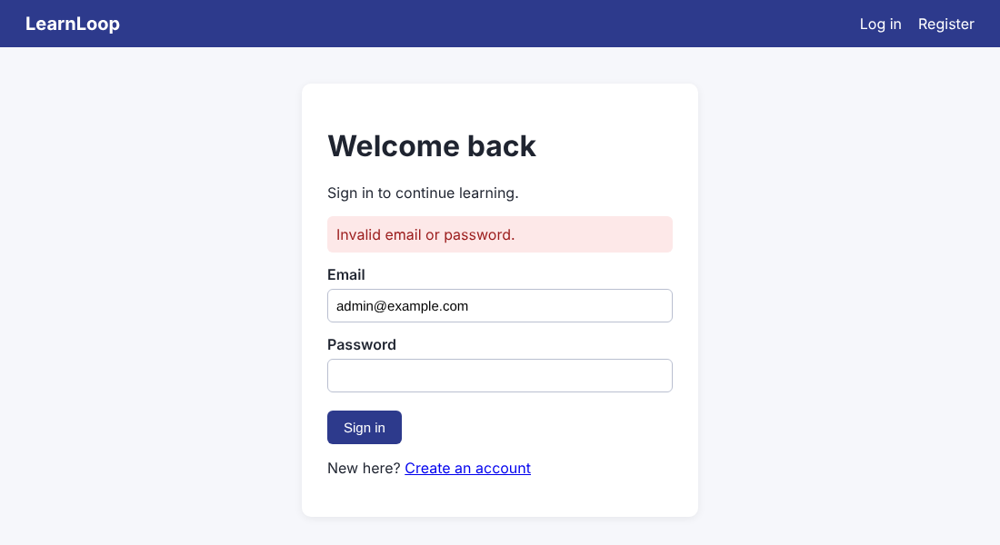
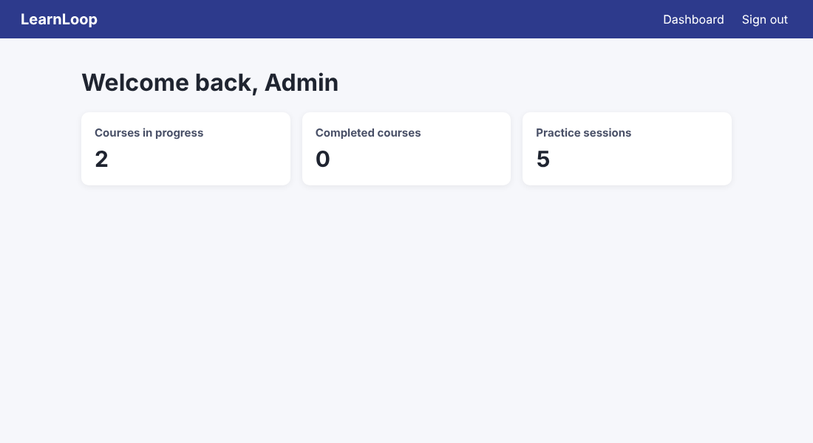

# Playwright login kata (C# / .NET / NUnit / Playwright for .NET)

[](https://github.com/ViktorVakareev/playwright-login-kata/actions/workflows/tests.yml)

From a recorded macro to a maintainable UI test suite. A sign-in flow is recorded with Playwright Codegen, then rebuilt step by step: page objects, role-based locators, data-driven negative tests, session handling, security checks, and traces on failure. It runs against **LearnLoop**, a small demo web app included in the repo, so everything works offline with one command.

*Based on the "Record Your First Macro" lab from Microsoft's [Automation, Advanced Testing, and AI](https://www.coursera.org/learn/automation-advanced-testing-and-ai) course on Coursera. Own code and own demo app; no course material is included.*

| Login with a refused sign-in | Dashboard after signing in |
|---|---|
|  |  |

## Changes from the original lab

1. **C# instead of TypeScript.** The lab records with Codegen's *Test Runner (TypeScript)* target and runs `npx playwright test`. Here everything is **Playwright for .NET with NUnit**, the stack used in .NET test teams. The recording is kept as it came out of Codegen's *C# NUnit* target, with the lab's two assertions added (`Recorded/RecordedLoginTests.cs`).
2. **Own app, no setup.** The lab's app only exists inside the course's lab desktop. LearnLoop is a made-up e-learning site written for this repo (ASP.NET Core, no database). The test run starts it on a free port and stops it afterwards, so there's no "start the app first" step and no clash with port 3000.
3. **From recording to suite.** One recorded test becomes 21: page objects, locators by role and label, data-driven negative cases, registration, sessions, a lockout, and basic security checks.
4. **The lab's gotcha, proven by a test.** The lab warns that "Welcome back" also appears on the login page, so checking only that text can pass even when sign-in fails. `Text_only_check_would_pass_without_signing_in` shows it, and the refined tests check the URL *and* the exact heading text.
5. **Debuggable failures.** Each test records a Playwright trace and keeps it only when the test fails; CI uploads the traces with the results.
6. **No secrets in tests.** The demo admin's credentials are read from the app's settings (override with `LEARNLOOP_ADMIN_EMAIL` / `LEARNLOOP_ADMIN_PASSWORD`); the saved-session test deletes its cookie file. The recorded test keeps literal credentials on purpose, to show what Codegen produces.

## What the lab asks you to do, and where it lives here

| Lab step | Here |
|---|---|
| Start the app (`bash start.sh`, `http://localhost:3000`) | `dotnet run --project src/LearnLoop.Web` (also on port 3000); the tests start their own copy |
| Check Playwright is installed (`npx playwright --version`) | `pwsh tests/LearnLoop.UiTests/bin/Debug/net10.0/playwright.ps1 --version` |
| Point Playwright at the browser (`playwright.config.ts`) | `playwright.runsettings`: browser, headless mode, expect timeout, parallel workers |
| Record the sign-in with Codegen | `playwright.ps1 codegen --target csharp-nunit http://localhost:3000` |
| Save it as `tests/login.spec.ts` and give the test a real name | `Recorded/RecordedLoginTests.cs` → `Admin_can_sign_in_and_reach_the_dashboard` |
| Add the URL and "Welcome back" assertions | The same test, URL first (the lab's "Common issues" tip) |
| Run it and see "1 passed" | `dotnet test --filter "FullyQualifiedName~Recorded"` |
| Prove the assertion works with a wrong password | Built in: `Invalid_sign_in_shows_an_error_and_stays_on_the_login_page` (5 cases) |

## The tests

| Class | Tests | What they cover |
|---|---|---|
| `Recorded/RecordedLoginTests` | 1 | The Codegen recording plus the lab's assertions |
| `Tests/LoginTests` | 11 | Happy path with exact heading text; 5 refused sign-ins (wrong password, unknown email with the *same* message, case-sensitive password, empty fields) with no session cookie created; email trimmed and case-insensitive; the "Welcome back" trap; Enter submits; failed sign-in keeps the email, clears and masks the password; lockout after 5 failures |
| `Tests/SessionTests` | 4 | Protected page → login → back to where you were; return URL to another site ignored (open redirect); sign out really ends the session; saved session (storage state) skips the login form |
| `Tests/RegistrationTests` | 5 | Register → confirmation → sign in → personalised dashboard; duplicate email in any case; password boundary (7 characters rejected); a name containing HTML is shown as text, never run (XSS) |

**Techniques:** page object model · role and label locators (`GetByRole`, `GetByLabel`) instead of CSS · web-first assertions that wait (`Expect(...).ToHaveTextAsync`) · data-driven `[TestCase]` · boundary values · state reuse with `StorageStateAsync` · tests that create their own data (`UniqueEmail()`) so they run in parallel · traces on failure.

## Run it

Needs the [.NET 10 SDK](https://dotnet.microsoft.com/download) and PowerShell (for Playwright's browser install).

```powershell
dotnet build
pwsh tests/LearnLoop.UiTests/bin/Debug/net10.0/playwright.ps1 install chromium   # once

dotnet test                                                    # all 21 tests, headless
dotnet test --filter "TestCategory=Login"                      # one area: Login, Session, Registration
dotnet test -- Playwright.LaunchOptions.Headless=false         # watch the browser
```

Try the app by hand, or record your own test:

```powershell
dotnet run --project src/LearnLoop.Web                          # http://localhost:3000, admin@example.com / admin12345
pwsh tests/LearnLoop.UiTests/bin/Debug/net10.0/playwright.ps1 codegen --target csharp-nunit http://localhost:3000
```

When a test fails, open its trace (time-travel through every step, with DOM snapshots and network calls):

```powershell
pwsh tests/LearnLoop.UiTests/bin/Debug/net10.0/playwright.ps1 show-trace tests/LearnLoop.UiTests/bin/Debug/net10.0/playwright-traces/<test>.zip
```

## Structure

```
src/LearnLoop.Web/            the demo app: home, log in, register, dashboard, sign out
  LearnLoopApp.cs             pages, cookie auth, anti-forgery tokens, safe return URLs, HTML encoding
  Users.cs                    in-memory users, salted PBKDF2 hashes, lockout after 5 failures
tests/LearnLoop.UiTests/
  Support/AppServer.cs        starts the app once per test run on a free port
  Support/UiTest.cs           base class: base URL, tracing on failure, unique test data
  Pages/Pages.cs              page objects: Home, Login, Dashboard, Register
  Recorded/                   the Codegen recording (the lab's approach)
  Tests/                      the refined suite
playwright.runsettings        browser, headless, timeouts, workers
```

## Lessons learned

- **A recording isn't a test.** Codegen writes the steps, not the checks. Without assertions the recorded script passes even when sign-in fails.
- **Assert the right thing in the right place.** "Welcome back" is on the login page *and* the dashboard; the URL plus the exact heading text is what proves the user got in.
- **Same message for wrong password and unknown email.** Different messages tell an attacker which accounts exist. The tests pin that behaviour.
- **Role and label locators beat recorded CSS.** They read like the user's view of the page and survive styling changes; they also fail loudly when a label is missing, which is an accessibility bug.
- **Don't lock the shared account.** The lockout test registers its own user; tests that share an account must never be able to break each other.
- **Recordings hard-code secrets.** Fine for a demo; in a real suite credentials come from configuration or a secret store.

## License

MIT for the code in this repository. Playwright is © Microsoft (Apache 2.0). The Coursera lab and its MindBridge app are not included.
